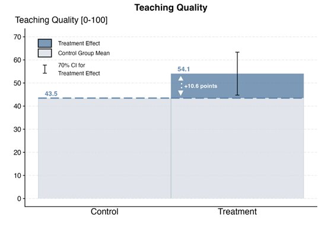
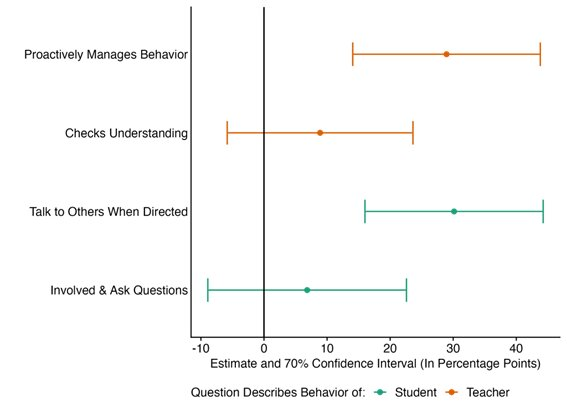

This post was originally posted on the IPA blog, and is re-posted here with permission: [https://poverty-action.org/principals-coaches-ab-test-suggests-it-can-work]()

*IPA’s Partnership for Tech in Education (P4T-Ed) initiative supports the use of data and evidence to drive learning and improvement in the edtech sector. As part of the P4T-Ed initiative, IPA is supporting three randomized controlled trials (RCTs) to help generate rigorous evidence on edtech interventions’ potential impact on learning outcomes.*

*This is the first blog post in a series highlighting key findings, insights, and lessons learned from the RCTs. The series showcases how evidence is helping bridge the gap between innovation, implementation, and impact in edtech.*

*In this post, the research team working with [Inspiring Teachers](https://inspiringteachers.org/) shares early results from work enabling school leaders to serve as instructional coaches.*

This blog summarizes the results of an A/B test evaluating the effectiveness of using school leaders as coaches within a structured pedagogy program in Ghana. Our results show that training school leaders and equipping them with app-based coaching tools can improve the quality of teaching in a structured pedagogy program. 

## Structured Pedagogy with Coaching

In early grade classrooms across Africa, children’s learning outcomes are falling short of global benchmarks for quality education. There is a growing consensus that structured pedagogy programs, which give teachers step-by-step lesson guides, and aligned student materials, offer a scalable solution. In 2025, the Global Education Evidence Advisory Panel (GEEAP) identified structured pedagogy as a *Best Buy* for governments seeking to improve foundational learning.

Coaching is widely regarded as an essential component of structured pedagogy. The advice is that coaches should visit classrooms, observe lessons, provide feedback, and model good practices. Often termed “supportive supervision,” the logic is that classroom visits offer a vehicle for guidance and soft accountability that leaves teachers feeling equipped and expected to deliver their daily lessons with fidelity. The problem is that sustaining an army of roaming coaches is costly, noted in IPA’s [2023 Best Bets](https://poverty-action.org/sites/default/files/2023-11/IPA-Best-Bets-Report-Updated.pdf) report which highlights teacher coaching as a promising intervention, for which more research is needed to determine how to achieve impact sustainably and at scale.

Many of the last generation of large-scale foundational literacy programs in Africa, such as those funded by USAID under the *All Children Reading initiative*, relied on external coaches. In the best of these, district staff were trained, equipped with tablets preloaded with coaching apps, and assigned to visit schools. The approach worked, but questions remained as to whether high-quality coaching could be scaled well within governments.

Implementation research ensued. [One RCT](https://scispace.com/pdf/implementing-large-scale-instructional-technology-in-kenya-55o0ya6ytf.pdf) showed that tablet-based observation tools could be used to assure coaching quality at scale. Programs with coaching were effective, but [a cost analysis of USAID reading programs](https://learningatscale.net/wp-content/uploads/2023/10/Learning-at-Scale-Cost-Analysis-Report_Final87.pdf) revealed that coaching was often the largest or second-largest ongoing cost of program delivery.

Optimists started exploring tech-facilitated remote coaching. In South Africa, [early work suggested that calling teachers could be a viable alternative, but later data showed that in-person coaching was more effective](https://www.dropbox.com/scl/fi/spuggxv6lw6knpva15ca9/Can-Virtual-Replace-InPerson-Coaching-Working-Paper.pdf?rlkey=9tt15x49ruc1k8toaobxou282&e=1&dl=0). Elsewhere, in Senegal, [“tele-coaching” was found to be cost-effective](https://r4d.org/wp-content/uploads/ACR-Tech-Brief-LPT-Coaching-CIES.pdf), but was ultimately not taken forward by the government, which chose to maintain the status quo approach by continuing to use a roaming staff model that delivered only infrequent school visits. This reminds us that political economy, institutional incentives, and even the way evidence is weighed all shape which reforms move forward.

Today, with foreign aid in retreat, the search for cost-effective approaches to supporting teachers in structured pedagogy programs has come to the fore. The question for anyone developing a program today is: *What version of this program could government systems actually deliver with quality?*

Inspiring Teachers, a nonprofit working in Ghana, Uganda, and Malawi, is using iterative design and testbed programs to answer this question in their Foundational Learning Improvement (TFLI) program tools. Our research group, with backing from IPA under the P4T-Ed Initiative and the Abdul Latif Jameel Poverty Action Lab (J-PAL) via the Learning for All Initiative, is supporting them in this journey. We are doing this through a series of A/B tests within a randomized controlled trials framework.

One of the innovations for the TFLI program is that its approach to structured pedagogy includes a digital layer: Classroom teachers, school leaders, and field staff are equipped with an app called SmartCoach, which is an offline-first mobile app that helps them run and track child learning assessments, school visits and teacher coaching, as well as providing videos of key pedagogical practices. Meanwhile, Inspiring Teachers program managers and government staff get a dashboard. Having extensive, real-time data on program implementation opens up new possibilities for research. Our current study has leveraged SmartCoach data to run our first A/B test comparing two different delivery models. 

## Can school leaders take on the role of coach?

One approach to make coaching more cost-effective would be to get school leaders to do it. School leaders (a.k.a. principals in the US or head teachers in much of the anglophone world) are already charged with managing teachers and giving them feedback on their performance. Getting them to support and supervise their teachers in implementing structured pedagogy would, therefore, be a natural extension of their responsibilities. However, school leaders have many other responsibilities—so they may not currently be providing teachers with instructional feedback, and even if they are, getting them to do it for a new program may be difficult.

To study the potential of this approach, we implemented an A/B test across our 40 treatment schools within an RCT testing the Inspiring Teachers TFLI program in Cape Coast, Ghana. Results from the first year of the RCT are very promising —and will be available in a forthcoming working paper!

[The idea behind A/B tests is to rapidly try out variations in a program to optimize its performance](https://www.wwhge.org/resources/a-b-testing-in-education-rapid-experimentation-to-optimise-programme-cost-effectiveness/). They are used widely in the tech sector to provide rapid insights rather than rigorous academic results. We thus adopted a lower initial statistical significance threshold for this test (70% rather than 95% significance), with a “significant” result guiding decision-making on which options to proceed with. We pre-specified the outcomes we would look at (test scores and teaching quality) internally, rather than posting an analysis plan to a public registry [as we did for the main RCT](https://www.socialscienceregistry.org/trials/14627). We analyzed the data in the same way as we will for our main study, to avoid fishing for significant findings.

In our A/B test, we randomly allocated 20 schools to each of two groups:

-   In Group “A” schools, only classroom teachers were given training on the literacy component (Inspiring Reading) of the TFLI program.
-   In Group “B,” everything was the same as Group “A”, with one addition: two leaders from each school were invited to a two-day training workshop where they were given an introduction to the science of reading, a walkthrough of the program, and training on using the SmartCoach app to observe and coach teachers.

We ran the A/B test for about two months, from the beginning of May 2025 through the end of the school year in June, at which time we gathered data on program fidelity, teaching quality, and children’s reading levels across both groups. Our data for this A/B test came from the same endline data collection we used in the main RCT: a set of reading assessments and classroom observations we conducted in June 2025. The classroom observations had enumerators record whether teachers engaged in various teaching activities and behaviors when teaching reading. 

## Our Results

The school leader training increased teaching quality by 10.6 points on our 0-100 teaching quality scale, as measured via observations by enumerators during the larger RCT at the endline (See Figure 1). Despite only running for two months, this effect clears our internal hurdle (70% significance) for an initially promising program change. What does this effect mean? The control group scored 43.5 points on our teaching quality scale and the treatment increased that number by 24 percent. We see that the quality gains were driven by behavior management, and class discussions, with other large but noisily estimated effects from students actively participating in in-class discussions, and teachers proactively checking students’ understanding of the material (See Figure 2). 

### Figure 1: Effect of School Leader Training Overall

### Figure 2: Effects on Components of Teaching Quality

An analysis of data from the main RCT suggests that a 0.54-SD improvement in teaching quality could lead to a 0.14-SD improvement in early grade reading assessment (EGRA) test scores, over a year of implementation. That is a meaningful increase—it is as big as the effect of the median education intervention, but comes from a fairly small supplement to an existing program.

This A/B test showed that training school leaders as in-school coaches can improve teaching quality and help teachers deliver structured pedagogy with greater fidelity.

In line with this finding, Inspiring Teachers opted to include school leader training as part of a package of support for 80 government schools in the Cape Coast Metropolitan District in August 2025. This was the first of our A/B tests, and we are now planning our next one, which will focus on parent engagement. Our findings suggest that school leaders have an important role to play in the successful delivery of structured pedagogy programs. Acknowledgements

This research is part of a study that was supported by the Jacobs Foundation and Innovations for Poverty Action via the Partnership for Tech in Education (P4T-Ed) Initiative and the Abdul Latif Jameel Poverty Action Lab (JPAL) via the Learning For All Initiative. The Inspiring Teachers TFLI program itself was established with catalytic support by the IDP Foundation and is now being expanded to government schools in partnership with Ghana Education Service, with support from the Global Schools Forum’s Impact at Scale Labs Program and the Prevail Fund.
