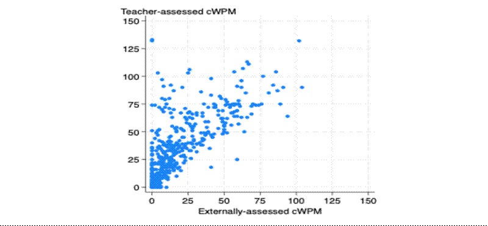
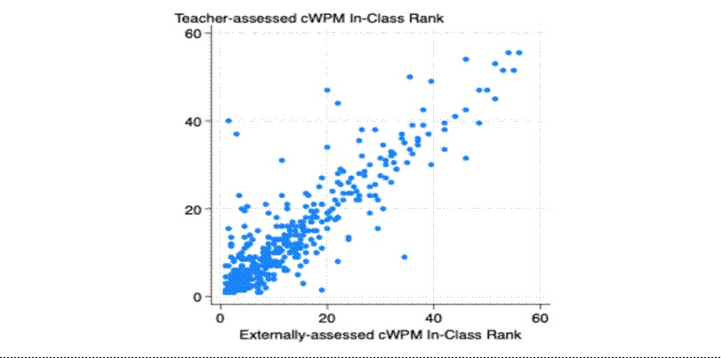

This post was originally posted on the IPA blog, and is re-posted here with permission: [https://poverty-action.org/can-teachers-accurately-assess-student-learning-what-evidence-shows](https://poverty-action.org/can-teachers-accurately-assess-student-learning-what-evidence-shows)

*IPA’s [Partnership for Tech in Education](https://poverty-action.org/p4t-ed) (P4T-Ed) initiative supports the use of data and evidence to drive learning and improvement in the edtech sector. As part of the P4T-Ed initiative, IPA and the [Jacobs Foundation](https://jacobsfoundation.org/) are supporting three randomized controlled trials (RCTs) to help generate rigorous evidence on edtech interventions’ potential impact on learning outcomes.*

*This is the second blog post in a series ([see first blog post](https://poverty-action.org/principals-coaches-ab-test-suggests-it-can-work)) highlighting key findings, insights, and lessons learned from the RCTs. The series showcases how evidence is helping bridge the gap between innovation, implementation, and impact in edtech.*

*In this post, the research team, working with [Inspiring Teachers](https://inspiringteachers.org/), shares insights from their work to explore the use of Teacher-led assessment.*

------------------------------------------------------------------------

Tailoring instruction to each student's level improves learning. To do it, teachers need to know where each student stands, which requires frequent assessment. Standardized tests are too rote for this, and paper assessments are too time-consuming to run often enough. Regular testing shows teachers who are falling behind and which skills students have mastered or still struggle with. Without this information, targeted instruction cannot work. Frequent testing also helps program implementers, who can make small changes to a program and see quickly whether those changes help.

The obstacle is cost. The standard approach sends an external data collection team into schools, which is expensive and hard to sustain. As programs grow, the cost of external assessment can become prohibitive, and the data often never reaches teachers at all.

This points to an alternative. If teachers ran the assessments themselves, schools could test students more often and at far lower cost, with no need to transport external assessors. The concern is accuracy. Teachers know their students well and have professional reasons to want them to perform, which could bias the scores. The question is whether teacher-led assessments are accurate enough for teachers and implementers to rely on. If they are, schools can monitor learning frequently as programs grow and target instruction more precisely.

## The Current Challenge of High Frequency Tests in Education Programs

Frequent testing helps teachers see which students are falling behind and adjust their lessons in response. Sending external assessors into every classroom to do that testing, however, is slow and expensive, and the results often never reach the teachers who need them. One alternative is to let teachers assess their own students. The obvious concern is accuracy, since teachers know their students and have reasons to want them to score well. A new study finds the concern is largely misplaced. In 40 schools, reading assessments run by teachers closely matched those run by independent assessors, at much lower cost.

IPA's Partnership for Tech in Education (P4T-Ed) initiative supports the use of data and evidence to improve learning in the education technology sector. Through P4T-Ed, IPA and the Jacobs Foundation are funding three randomized controlled trials (RCTs) that test how education technology tools affect learning outcomes. This is the second post in a series on what the trials are showing. This installment draws on the trial conducted with Inspiring Teachers, which tested whether teachers can assess their own students reliably.

For teachers, rapid assessments provide immediate and regular feedback required to tailor instruction to their students’ needs. Assessing students frequently helps identify who is falling behind and which skills students are mastering or struggling with. Without this timely information, targeted instruction programs are doomed to fail. Rapid assessments are also an important component of implementation monitoring. Program implementers can test small design tweaks and receive immediate feedback on their effectiveness.

However, running rapid assessments using the traditional setup of deploying an external data collection team carries heavy logistical and personnel costs. Reliance on external assessments can become prohibitive and constrain efforts to scale up programs. In many cases, the data from external assessments never reaches teachers.

This creates an opportunity: what if teachers could run the assessments themselves? Without having to transport external data collectors to schools, teacher-led assessments are far more cost-effective and can be run more frequently. Teachers’ close relationships to their students along with professional incentives to have high performing students raise the danger that teachers could tip the scales in their favor and bias the results. So, can teacher-led assessments be accurate enough for teachers and implementers to rely on? If they can, teachers and implementers could unlock the benefits of high frequency monitoring as programs scale and develop, potentially delivering better tailored instruction within more fully developed programs.

## How Teacher-Led Assessments Work

The program we are testing uses SmartCoach, a smartphone application developed by Inspiring Teachers, to deliver foundational literacy materials. During class, a teacher uses the application to give each student a one-minute oral reading test, drawn from the Early Grade Reading Assessment (EGRA), a widely used measure of reading fluency. The student reads a short passage aloud while the teacher taps any words read incorrectly. The application records the time taken and the errors, then calculates the student's reading speed and accuracy. The teacher repeats the test with every student in the class. Recording answers in real time reduces scoring errors and removes the delay between testing and grading. Because the test is digital, results are available immediately. SmartCoach ranks each student against national reading benchmarks and summarizes how far each child has progressed on foundational skills such as phonemic awareness and letter-sound knowledge. Teachers use these summaries to complete parent report cards and identify students who are struggling, and to see which reading skills need special attention.

Results from these assessments are immediately available because the tests are digital and reading scores are automatically generated. The data also allows the teacher to group students to provide targeted instruction and give specific support to learners who need it most. Over time, teachers can monitor students’ progress and identify who is falling behind, and when.

## Do Teacher-Led Assessments Produce Reliable Results?

[Our study](https://documents.worldbank.org/en/publication/documents-reports/documentdetail/099222207302611441) provided a perfect opportunity to test the accuracy of teacher-led assessments. The research team randomly assigned 40 of 80 schools to receive Inspiring Teachers’ foundational literacy program. Teachers in all 40 treatment schools ran reading fluency assessments of their grade one pupils as part of the program. The team then hired external contractors to conduct literacy assessments with those same pupils, producing two scores for each student- one obtained from the teacher evaluation and the other from the external contractors. 

The teacher-led assessments closely matched the results of external assessments. Statistically, the tests are highly correlated at 0.72 (R-squared = 0.52). Figure 1 shows this visually. Teachers and external evaluators agreed on which students were strong readers and which were weak though they differed on the level of the reading score. On average, teachers scored each student as a stronger reader than external evaluators did. Because the reading passages were not identical across the two tests, this gap may simply reflect an easier passage in the teacher-led version. 

**Figure 1: Correlation between teacher assessment and external assessment exam scores**\
**{alt="Figure 1: Correlation between teacher assessment and external assessment exam scores"}**

[Recent research has argued](https://voxdev.org/topic/education/mismeasuring-learning-beware-psychometric-test-scores) that raw reading scores may differ for myriad reasons, so assessments are most useful for ranking students’ reading ability within classes. The agreement is even stronger taking this into account. The correlation for the within classroom ranking is 0.89 (R-squared = 0.79) which we show in Figure 2. This reinforces the value of teacher-led assessments as a practical tool for ongoing classroom monitoring. There is almost a one-to-one correspondence between the teacher-led and external classroom ranks. This suggests that teacher-led assessments identify which students within a class are stronger or weaker readers as well as external assessments do, reinforcing their value as a practical tool for ongoing classroom monitoring.

**Figure 2: Correlation between teacher assessment and external assessment within-class rank**

## What the Results Mean for Schools and Education Programs?

These results are very encouraging and open cheaper options for program evaluation and A/B testing for any education programs including our own ongoing research. Programs and schools can evaluate the effects of tweaking design features or light-touch interventions within larger foundational literacy programs using the internal assessments teachers are already running, without the need for expensive fieldwork. Other genres of education programs could also add teacher-led assessments to unlock the benefits of cheap testing.

Additionally, the fact that teacher-led assessments are trustworthy allows additional A/B testing to be extended to schools in the broader Inspiring Teachers program that are not part of the larger randomized controlled trials. Adopting teacher-led assessments allows programs to generate critical evidence for continuous program improvement. The immediate feedback from the assessments supports targeted instruction and allows program implementers to be more responsive and deploy resources where they are most needed and are likely to have the greatest impact.

External assessments remain crucial. Periodically ensuring measurements stay honest, teacher-led assessments can give teachers and schools timely, reliable and actionable data without deploying time consuming and prohibitively costly external testing. Teacher-led assessments offer a practical way to support continuous improvement as well as scale evidence-informed instruction in a cost-effective manner. 
